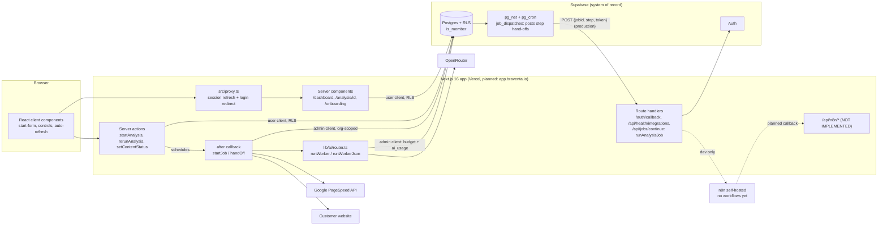
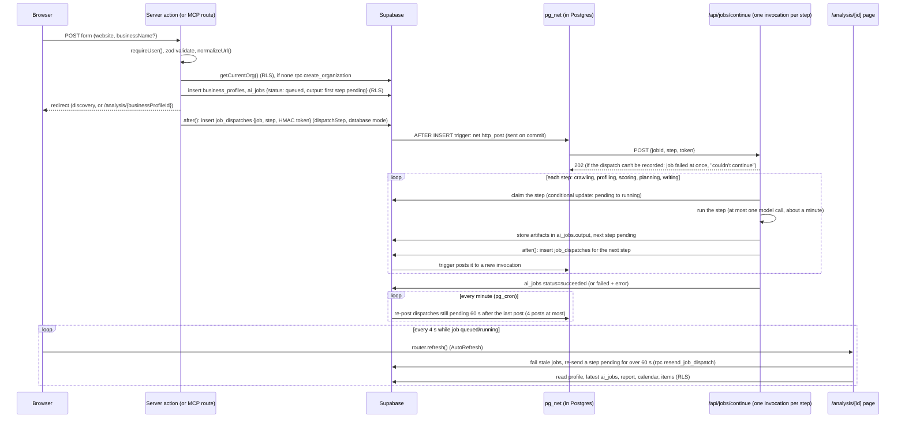

# System architecture

This document describes how Braventa (repository codename GrowthOS) is put together today: the layers,
where each runs, how the MVP website-analysis job flows through the system, which environments and
domains exist, and where the repository differs from the founder brief. It describes the code as it is;
anything not built is labelled **Planned** or **Not implemented**. Companion documents:
[DATA_MODEL.md](DATA_MODEL.md), [AI_ROUTING_AND_COSTS.md](AI_ROUTING_AND_COSTS.md),
[INTEGRATIONS.md](INTEGRATIONS.md), [SECURITY_AND_PRIVACY.md](SECURITY_AND_PRIVACY.md). Scope lives in
[../product/MVP_SCOPE.md](../product/MVP_SCOPE.md); decisions in
[../decisions/DECISION_LOG.md](../decisions/DECISION_LOG.md); unresolved items in
[../decisions/OPEN_QUESTIONS.md](../decisions/OPEN_QUESTIONS.md).

**Status / last reviewed: 2026-10-10** (against commit `17ab57a` plus the uncommitted MVP pipeline work).

---

## 1. Layers

| Layer | Technology | Responsibility | State today |
|---|---|---|---|
| Frontend + server | Next.js 16.4 App Router (`web/`, `src/`), React 19.3, Tailwind 4, Cache Components enabled (`next.config.ts`) | UI, server components, server actions, route handlers, background work via `after()` | Live (local dev; Vercel deployment planned at `app.braventa.io`, D-011) |
| System of record | Supabase (project ref `mlztvhvmsullvwawwamc`): Postgres + Auth + RLS, `pgvector` extension | All tenant data, auth, authorization (RLS via `public.is_member()`), job state, AI usage ledger | Live |
| Workflow execution | n8n, self-hosted at `n8nautomations.pixelmarketingdesign.com` | Intended: scheduled and long-running workflows that call back to `/api/n8n/*` | **Configured only.** Client in `web/src/lib/integrations/n8n.ts`; no workflows exported (`n8n/` is empty); no `/api/n8n/*` routes exist |
| AI routing | `web/src/lib/ai/router.ts` over OpenRouter (`web/src/lib/integrations/openrouter.ts`) | Worker -> task class -> model chain, budget check, usage logging | Live |
| External integrations | Google PageSpeed Insights, a cheerio-based crawler | Website measurement and content extraction | Live. Everything else (HubSpot, GA4, Search Console, Stripe, WordPress, publishing) is Planned — see [INTEGRATIONS.md](INTEGRATIONS.md) |

Binding rules (from `CLAUDE.md`; restated so architecture reviews can check against them):

1. Supabase is the system of record. n8n only executes workflows and calls back to `/api/n8n/*`; it never
   owns state that the app cannot reconstruct.
2. Every tenant table has `organization_id` and RLS via `public.is_member()`.
3. AI calls go through `runWorker` / `runWorkerJson`. Features never call OpenRouter directly.
4. Secrets are server-only (`web/src/lib/env.ts` imports `server-only`). Never prefix a secret with `NEXT_PUBLIC_`.
5. `createSupabaseAdminClient()` bypasses RLS: trusted server code only, always scoped by an organization
   id that has already been authorised.
6. Human approval is the default before anything is published for a client (D-013).

## 2. Diagram

## 3. Request and job flow: the MVP analysis pipeline

Step by step (code references are to `web/src/`):

1. **Entry.** `/onboarding` renders `StartForm` (client) which calls the `startAnalysis` server action
   (`app/analysis/actions.ts`).
2. **Validate and authorise.** `requireUser()` (`lib/auth.ts`) resolves the user via
   `supabase.auth.getUser()`. Input is validated with zod and normalised with `normalizeUrl()` (adds
   `https://` if missing, strips the hash).
3. **Tenant.** `getCurrentOrg()` returns the first membership (MVP: one org per user). If the user has none,
   the action calls the `create_organization` RPC, which creates the org and an `owner` membership in one
   SECURITY DEFINER transaction.
4. **Queue.** A `business_profiles` row and an `ai_jobs` row (`worker = 'website_evidence'` for a new
   analysis, `'website_intel'` for a re-run; `task_class = 'complex'`; `input = {businessProfileId, websiteUrl,
   sessionId?}`; `output` = its first step, pending) are inserted **with the user's client**, so RLS proves
   membership before anything runs.
5. **Run.** `startJob` (`lib/pipeline/handoff.ts`) hands the first step to `/api/jobs/continue` in `after()`
   (in production by recording it for Postgres to send, see below), so even the first step runs in its own
   invocation with the full time limit, whatever the queuing request already spent. The user is redirected to
   discovery or `/analysis/{profileId}`.
6. **Pipeline** (`lib/pipeline/website-intel.ts`) uses the **admin client**. It loads the job by id and takes
   `organization_id` from the job row (which RLS already vetted at insert time), and scopes every write with
   that id. Steps, each recorded in `ai_jobs.output.step`: `crawling` -> `profiling` -> `scoring` ->
   `planning` -> `writing` -> `done`.
   - **Step chaining** (`lib/pipeline/steps.ts`, 2026-10-17): each step runs in its own function invocation, so
     no invocation reaches Vercel Hobby's 300 s limit. `runAnalysisJob(jobId, step)` claims the pending step
     with a conditional update on `output.step`/`output.step_state`, runs it, stores what later steps need in
     `ai_jobs.output`, queues the next step and calls `dispatchStep` (`lib/pipeline/dispatch.ts`), which gets
     `{jobId, step, token}` to `/api/jobs/continue` at `NEXT_PUBLIC_APP_URL`. The route checks the HMAC token
     (`lib/pipeline/continue-token.ts`), answers 202 and runs the step in its own `after()` (`maxDuration` 300).
     The first step is handed off the same way, from the `after()` of whatever queued the job (server action or
     MCP route). Evidence jobs run `crawling`, `profiling`; plan jobs `scoring`, `planning`, `writing`; re-runs
     all five; corrections only `scoring`. When an evidence job finishes and discovery is done, the plan job is
     queued at `scoring` and handed off the same way.
   - **Dispatch modes** (`JOB_DISPATCH`, amended D-042 2026-10-17): Vercel answers a deployment calling itself in a
     chain with HTTP 508 (loop detection, about four calls), which failed the 5th step of a production re-run. So in
     production (`database`, the default when `VERCEL=1`) the app never calls itself: it inserts the hand-off into
     `public.job_dispatches` with the service client, and Postgres POSTs it with `pg_net` from an `AFTER INSERT`
     trigger once the insert commits; a `pg_cron` sweeper re-posts a step still pending a minute after its last post
     (4 posts at most). Locally (`direct`, the default elsewhere) the app POSTs to its own route, at the dev server's
     own port (`PORT`, which `next dev` sets to the port it listens on), since Supabase can't reach localhost.
   - **Hand-off failures** (`lib/pipeline/handoff.ts`, `jobs.ts`): `dispatchStep` never throws. Direct mode retries
     timeouts, 408, 429 and 5xx (3 attempts); database mode retries dropped connections (3 attempts) but not a
     missing table or a refused write. A hand-off that can't be recorded or isn't accepted fails the job at once
     ("The analysis couldn't continue. Run it again."). A step still pending 60 s after it was queued (accepted but
     never claimed) is re-sent by the report page's poll, at most once a minute (database mode: Postgres re-posts
     the stored dispatch, `resend_job_dispatch`); the claim makes repeats harmless.
   - Crawl (max 6 same-host pages, 6,000 chars each, 15 s timeout and 2 MB cap per fetch, public addresses
     only — see [SECURITY_AND_PRIVACY.md](SECURITY_AND_PRIVACY.md#7-prompt-injection-posture)) and PageSpeed (mobile) run in
     parallel; PageSpeed failure is tolerated.
   - Growth score is **deterministic code** (`computeGrowthScore`): a weighted blend of three AI-assessed
     scores and four PageSpeed scores (weights renormalised if PageSpeed is unavailable).
   - Four AI calls via `runWorkerJson`: `business_analyst`, `website_auditor`, `content_strategist`,
     `content_writer`. Each output is zod-validated; a bad parse is retried once.
   - Drafted posts are written with `status = 'needs_approval'`. Nothing is published; no publishing
     integration exists.
7. **Failure.** Any thrown error marks the job `failed` with the error message (shown on the analysis page), and
   a refused hand-off with "couldn't continue". A step cut off by the platform, or one whose re-sends never got it
   claimed, is marked failed by `failStaleJobs` (`lib/pipeline/jobs.ts`) 10 minutes after the step's last
   progress (`output.step_started_at`, else `created_at`). A failed job keeps at most `{step}` in its output: the
   page text, evidence and discovery answers held between steps are dropped.
8. **Polling.** `/analysis/[id]` is a server component inside `<Suspense>` (required with Cache Components
   because it reads cookies). While the latest job is `queued`/`running` it mounts `AutoRefresh`, which calls
   `router.refresh()` every 4 seconds. No websockets or Supabase Realtime are used.
9. **Approval.** `setContentStatus` (server action, user client, RLS) sets `approved` / `rejected` /
   `needs_approval` and records `approved_by` / `approved_at`.
10. **Re-run.** `rerunAnalysis` queues a new job for an existing profile; history is preserved (new report,
    calendar and items each run; the page shows the latest of each).

Runtime: with `AI_MODE=free` a run takes about 3–4 minutes and consumes 4 OpenRouter requests (up to 8 with JSON
retries) of a shared ~50 free requests/day per API key.

### In-process `after()` vs n8n: trade-off and when to move

The brief and `CLAUDE.md` assign workflow execution to n8n. The pipeline currently runs **in-process via
`after()`** instead. This is acceptable for the proof of concept, with known limits:

| | In-process `after()` (today) | n8n workflow (target) |
|---|---|---|
| Simplicity | One codebase, typed, zod-validated, uses `runWorker` directly | Second system; JSON workflows; must call back into the app for every AI step to keep the routing rule |
| Duration | Each step runs in its own invocation (`maxDuration` 300 on the routes that start or continue a job) and takes about a minute; the steps are chained through `/api/jobs/continue` | Long-running and scheduled jobs are native |
| Durability | A hand-off that can't be recorded (or, locally, is refused) fails the job at once; in production Postgres re-posts one that never ran every minute (4 posts at most), and the report page re-sends it after 60 s while open; a step that dies mid-run is failed by the reaper 10 minutes after its last progress (the step itself is never retried) | Execution history, retries, error workflows |
| Scheduling | None | Cron, delays, follow-ups |
| Observability | `console.error` + `ai_jobs.error` | n8n execution log + `ai_jobs.n8n_execution_id` (column already exists) |

**Recommendation.** Keep the step chain for the MVP. D-042 already handles what used to be the trigger to move, a
run longer than the host's max duration: each step is its own invocation (about a minute, `maxDuration` 300),
the stale-job reaper fails steps that die, and lost hand-offs are re-sent (in production by Postgres, without the
report page open; the hand-offs go through `pg_net` because Vercel's loop detection refuses a deployment calling
itself in a chain). Move to n8n (or a queue) when any of these is true: a single step no longer fits one invocation
(a much larger crawl, or a step with several model calls), a feature needs scheduling or retries of failed steps
(recurring audits, CRM syncs, follow-ups), stale jobs must be failed without anyone opening the app (the reaper
runs only when the dashboard, the report page or a new run looks at the organization's jobs), or concurrent runs
start timing out. When moving, keep the pipeline logic in the app and have n8n orchestrate by calling authenticated
app endpoints (the continue route is already one), so AI routing, budgets and RLS-scoped writes stay in one place.

## 4. Auth and request gate

- `src/proxy.ts` (Next 16's replacement for middleware) refreshes the Supabase session cookie on every
  matched request and redirects signed-out visitors to `/login?next=...`. Public paths: `/`, `/login`,
  `/auth/*`, `/api/health/*`, `/api/mcp` (authenticates with a personal access key itself, D-036), `/api/jobs/continue`
  (checks an HMAC of the job id and step itself, D-042). It is a convenience gate only; authorization is enforced by RLS and
  `requireUser()`.
- Any future `/api/n8n/*` callback route is **not** in `PUBLIC_PATHS`, so n8n calls (which carry no Supabase
  session) would be redirected to `/login`. Adding the route requires adding `/api/n8n` to `PUBLIC_PATHS`
  and authenticating with the shared secret instead.
- Details: [SECURITY_AND_PRIVACY.md](SECURITY_AND_PRIVACY.md#4-authentication).

## 5. Environments and domains

| Environment | URL | Hosting | Status |
|---|---|---|---|
| Local development | `http://localhost:3000` (`npm run dev` in `web/`, `.claude/launch.json`) | Developer machine | Live |
| Production app | `https://app.braventa.io` | Vercel project `braventa-app` (Hobby tier during the proof of concept, D-011); root directory `web`, production branch `main`; env vars set for Production only (`AI_MODE`, Supabase URL/publishable key/secret key, OpenRouter, Google, `NEXT_PUBLIC_APP_URL`) | **Deploying** (2026-10-11); private: robots.txt disallow, `X-Robots-Tag` noindex/nofollow, invite-only sign-up |
| Marketing site | `https://braventa.io` (`www` redirects to it) | Vercel project `braventa-site` (root `site`, production branch `main`; Config env vars `NEXT_PUBLIC_SUPABASE_URL`/`_PUBLISHABLE_KEY` for the contact form only, no secrets); Hostinger is registrar and DNS: A `@` → Vercel, CNAME `www` → Vercel (D-031, D-033) | **Deploying** (2026-10-11); hidden from search engines until `SITE_INDEXABLE=true` |
| Support and docs | `https://support.braventa.io` | Next.js + Fumadocs in this repo on Vercel (D-031) | **Planned** |
| Community | `https://community.braventa.io` | Hosted forum (Q-017) | Future |
| Database / auth | Supabase project `mlztvhvmsullvwawwamc` | Supabase cloud | Live; one project serves all environments today |
| Workflow engine | `n8nautomations.pixelmarketingdesign.com` | Self-hosted (host provider not recorded in repo) | Reachable via API key; no workflows |
| Google APIs | GCP project `growth-os-511206` | Google Cloud | PageSpeed key in use |

There is **no staging environment** and no separate Supabase project for development: local development
writes to the same database a deployed app would use. Configuration is by environment variables listed in
`web/.env.example`: `NEXT_PUBLIC_SUPABASE_URL`, `NEXT_PUBLIC_SUPABASE_PUBLISHABLE_KEY`,
`SUPABASE_SECRET_KEY`, `AI_MODE`, `OPENROUTER_API_KEY`, `N8N_BASE_URL`, `N8N_API_KEY`,
`N8N_WEBHOOK_SECRET`, `GOOGLE_API_KEY`, `NEXT_PUBLIC_APP_URL`. Production must set `NEXT_PUBLIC_APP_URL`
to `https://app.braventa.io` (used for sign-up email redirects and the OpenRouter referer) and Supabase Auth's
Site URL / redirect allow-list to match.

## 6. Brief vs repository

The brief (§7) describes intent "subject to repository inspection". Discrepancies found:

| # | Brief says | Repository / infrastructure shows | Recommendation |
|---|---|---|---|
| 1 | n8n self-hosted on **Oracle Cloud** | Configured instance is `n8nautomations.pixelmarketingdesign.com` (an existing agency domain); host provider unknown | Record the actual host in OPEN_QUESTIONS (Q-006). Before client data flows through n8n, move it to a Braventa-controlled host/subdomain (e.g. `n8n.braventa.io`) so tenant data does not transit an unrelated agency's infrastructure |
| 2 | Marketing site on **Hostinger** | App will be on Vercel at `app.braventa.io`; Hostinger hosts `braventa.io` and DNS | No conflict (D-011). Hostinger = marketing site + DNS only |
| 3 | n8n handles workflow execution, scheduling, orchestration | No workflows, no `/api/n8n/*` routes; the MVP pipeline runs in-process via `after()` | Acceptable for the PoC; see section 3 for the move criteria. Do not describe n8n automation as live |
| 4 | Supabase for data, auth, **storage**, permissions, business knowledge | Data, auth, RLS live. Storage: no buckets or code. Knowledge: `knowledge_documents` written; `knowledge_chunks` / `match_knowledge` (embeddings) never populated or queried | Label storage and retrieval as Planned. Decide embedding model and chunking before building the assistant |
| 5 | AI routing tracks model, tokens, **latency, failures**, cost; caching; quality evaluation before downgrading | Model, tokens, cost logged; latency, failures, cache: not implemented | See [AI_ROUTING_AND_COSTS.md](AI_ROUTING_AND_COSTS.md) section 6 |
| 6 | Protected connected-account credentials | `integrations.vault_secret_id` column exists; no code writes tokens; Vault not configured | Planned; required before HubSpot (see [SECURITY_AND_PRIVACY.md](SECURITY_AND_PRIVACY.md)) |
| 7 | Logging of sensitive operations | Only `ai_usage` and `ai_jobs`; no audit log of approvals, membership changes, or admin actions beyond `approved_by` | Add an `audit_events` table before multi-user orgs or publishing |
| 8 | HubSpot first CRM | Not implemented; health route says "Sprint 5" | Planned; see [INTEGRATIONS.md](INTEGRATIONS.md#hubspot-first-plan-planned) |
| 9 | Billing | `subscriptions` table with Stripe columns; no Stripe code; provider not formally chosen | Treat Stripe as provisional until decided; pricing undecided (D-012) |
| 10 | Brand is Braventa (D-001) | Resolved 2026-10-10: user-visible strings (page titles, header, onboarding/login copy), OpenRouter `X-Title`, and crawler User-Agent now say Braventa | Only the internal n8n header `X-GrowthOS-Secret` remains (Q-020); code identifiers intentionally unchanged |
| 11 | Vercel Hobby during PoC | Vercel Hobby is intended for non-commercial use | Move to a paid plan before charging customers (already noted in the infrastructure plan) |
