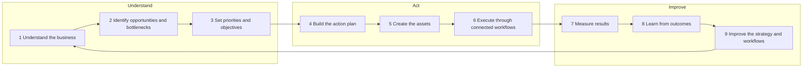

# Braventa — Business methodology

This document defines how Braventa thinks about a customer's business: the Braventa Growth Loop
(three stages, nine steps), the business intelligence layer that feeds it, the layer that turns
intelligence into executed work, and the continuous-improvement layer that closes the loop. For each
step it states the input, the output, the responsible module, and the honest current status with
evidence from the code. Product and UI work should be traceable to a step in this loop.

**Status / last reviewed: 2026-10-10.** Loop structure per D-004 (Provisional) in
[DECISION_LOG.md](../decisions/DECISION_LOG.md). Status column verified against the code on `main`
(`17ab57a` plus working-tree changes).

Status keys: **Live** — works end to end in the app today. **Partial** — some of the step works; the
gap is stated. **Planned** — nothing user-facing exists (schema tables alone do not count).

---

## 1. The Braventa Growth Loop

The loop is a methodology, not a feature, and it is never described as fully automated (D-004).
Public name: "the Braventa Growth Loop", then "the Growth Loop".

### Stage 1 — Understand

| Step | Input | Output | Module | Status | Evidence / gap |
|---|---|---|---|---|---|
| **1 Understand the business** | Website URL and optional business name (today); later: uploaded documents, customer answers, connected CRM and analytics | Structured business profile: summary, industry, services, target customers, locations, offers, unique value, brand voice, likely competitors, strengths, gaps. Crawled pages stored as knowledge documents | A Business Intelligence (with D Website Intelligence) | **Partial** | `web/src/lib/pipeline/website-intel.ts` crawls up to 6 pages (`crawler.ts`), runs the `business_analyst` worker, writes `business_profiles.intelligence` and a `brand_profiles` row, and upserts `knowledge_documents`. Gaps: website is the only source; the customer cannot review or edit the profile; stored pages are never chunked, embedded, or retrieved (`knowledge_chunks` / `match_knowledge` unused); `business_profiles.goals` is never written. |
| **2 Identify opportunities and bottlenecks** | Business profile, crawl signals (HTTPS, meta description, H1s, contact form, phone, schema, missing alt text, social links), Google PageSpeed (mobile) | Three assessed scores (content clarity, conversion readiness, online presence), a deterministic growth score, five opportunities each with area, evidence, first step, impact, effort | B Marketing Strategy, D Website Intelligence | **Live** (website-based) | `website_auditor` worker plus `computeGrowthScore()` in `website-intel.ts`; stored as a `reports` row (`report_type = growth_plan`); rendered in `web/src/app/analysis/[id]/page.tsx`. CRM-side bottlenecks are Planned. |
| **3 Set priorities and objectives** | Opportunities; customer goals and constraints | Agreed priorities and objectives the plan is built against | B Marketing Strategy | **Partial** | Opportunities are ranked by the AI and labelled impact/effort; the plan's `primary_goal` is inferred by the AI. The customer cannot set, reorder, accept, or dismiss priorities, and no goals are captured. |

### Stage 2 — Act

| Step | Input | Output | Module | Status | Evidence / gap |
|---|---|---|---|---|---|
| **4 Build the action plan** | Profile, top opportunities, (later) objectives | 30-day content strategy (goal, audience, 3–4 pillars, channels) and at least 20 dated calendar items | B Marketing Strategy, C Content Studio | **Partial** | `content_strategist` worker writes `content_calendars` and `content_items` (status `brief`, shown as "Planned"). Gap: the plan covers content only; non-content opportunities (website fixes, CRM follow-up) do not become plan items or tasks. |
| **5 Create the assets** | Plan items, brand voice, services, audience | Ready-to-review drafts with title, body, CTA, hashtags, image idea | C Content Studio | **Partial** | `content_writer` worker drafts the **first five** plan items and sets them to `needs_approval`. Gaps: remaining items stay as briefs; no editing, regeneration, long-form formats, or QA review (`qa_reviewer` worker defined in `router.ts` but never called). |
| **6 Execute through connected workflows** | Approved assets and tasks; connected tools | Published content, sent emails, CRM tasks, logged executions | F Automation (with C, E) | **Partial — approval only** | Approve / Reject / Undo works (`setContentStatus` in `web/src/app/analysis/actions.ts`; `approved_by`, `approved_at` recorded). Nothing is scheduled, published, exported, or sent. No n8n workflow is triggered by the app (`triggerWebhook` in `web/src/lib/integrations/n8n.ts` is unused; no `/api/n8n/*` routes exist). |

### Stage 3 — Improve

| Step | Input | Output | Module | Status | Evidence / gap |
|---|---|---|---|---|---|
| **7 Measure results** | Execution records, analytics, CRM outcomes, approval data | Activity and outcome reporting | G Analytics and Optimization | **Planned** | `ai_usage` logs model, tokens, and cost per call, and content status is stored, but there is no reporting UI and no external performance data. |
| **8 Learn from outcomes** | Planned vs actual comparisons | Identified underperforming content and workflows | G | **Planned** | Nothing implemented. |
| **9 Improve the strategy and workflows** | Learnings | Updated priorities, plan, and workflow changes; next best action | B, F, G | **Planned** | "Re-run analysis" exists but repeats the assessment from scratch; it does not use prior outcomes. |

## 2. Business intelligence layer

**Purpose:** understand the business progressively and keep that understanding in a structured,
reusable profile so the AI does not rediscover the business on every request (brief §2.1).

### 2.1 What the profile covers

| Dimension (brief §2.1) | Captured today | Source today | Planned source |
|---|---|---|---|
| Business model and services | Yes | Website (AI) | Customer edits, documents |
| Target customers and buying motivations | Customers yes; motivations no | Website (AI) | Customer input, CRM |
| Brand identity and tone of voice | Tone and traits | Website (AI) | Customer edits, brand documents |
| Products, offers, differentiators | Yes | Website (AI) | Customer edits |
| Website and digital presence | Signals and PageSpeed | Crawl, Google PageSpeed | Search Console, GA4 |
| Acquisition channels | Social links only | Crawl | Analytics, CRM |
| Sales process and CRM structure | No | — | HubSpot |
| Existing marketing assets | Crawled pages | Crawl | Uploads, connected tools |
| Connected applications and workflows | No | — | Integrations |
| Goals, constraints, priorities | No (`goals` column unused) | — | Customer input |
| Performance data | No | — | Analytics, CRM |

### 2.2 Information provenance classes

Every fact or recommendation Braventa shows belongs to exactly one of four classes. The class must
be stored with the data and visible in the UI, so the customer can tell what Braventa measured, what
they told it, what it guessed, and what it suggests.

| Class | Definition | Examples | UI label (proposed) | Treatment |
|---|---|---|---|---|
| **Verified** | Measured or observed directly from a system, by deterministic code, at a known time | PageSpeed scores; HTTPS present; number of images missing alt text; pages found; later, CRM record counts | "Measured" with the source name and date (for example, "Measured · Google PageSpeed · 10 Oct") | Shown as fact; refreshable; never rewritten by AI |
| **Customer-provided** | Entered or explicitly confirmed by the customer | Business name and website URL entered at onboarding; later, edited services or goals | "From you" | Highest authority for profile facts; AI must not overwrite it |
| **Inferred** | Derived by AI from verified or customer-provided sources | Industry, summary, services, target customers, brand voice, likely competitors, the three assessed scores | "Inferred from your website" (or other source) | Editable; editing converts it to Customer-provided; "unknown" is shown as missing, not as a value |
| **AI-recommended** | A suggestion about what to do | Opportunities, first steps, the 30-day plan, drafted posts | "Recommendation" or "Draft" plus the reason ("why") | Always requires human review; approval is recorded |

**Current implementation:** only partial. The analysis page marks PageSpeed bars with a "Google"
note and explains the growth score as a "blend of measured site quality and assessed marketing
readiness"; drafts are labelled with approval status. Profile fields are not labelled as inferred,
and provenance is not stored per field. The growth score is a mixed value (deterministic weighting of
verified PageSpeed scores and inferred AI scores in `computeGrowthScore()`); the UI must keep saying so.

**Rule for future work:** a new data field or AI output is not done until its provenance class is
decided, stored, and labelled.

## 3. Intelligence-to-execution layer

**Purpose:** turn understanding into work that actually gets done (brief §2.2). Braventa should not
stop at a recommendation when a connected, tested workflow can carry out the next step — but it must
never claim an integration or automated action exists before it is built and tested.

| Recommendation type (brief §2.2) | Output today | Next execution step | Status |
|---|---|---|---|
| Growth opportunities | Five opportunities with first steps | Turn into tracked tasks | Live (recommendation only) |
| Website and conversion recommendations | Inside the five opportunities | Dedicated prioritised website plan | Partial |
| SEO priorities | Inside the opportunities (PageSpeed SEO score, crawl signals) | Search Console data, keyword priorities | Partial |
| Content strategies and calendars | 30-day plan | Edit, schedule, publish via connected tools | Live (plan) |
| Campaign briefs and marketing assets | First five drafts | Campaigns (`campaigns` table exists, unused), more formats | Partial |
| Lead-management and CRM workflow recommendations | None | HubSpot read-only summary, then tasks | Planned |
| Automation opportunities | None | n8n workflow templates with approval steps | Planned |
| Follow-up tasks | None | Tasks generated from CRM and plan | Planned |
| Performance summaries and next actions | None | Weekly summary | Planned |

**Execution principles**

1. **Approval by default (D-013).** Anything published or sent for a client needs explicit human
   approval unless the client has configured an authorised automation.
2. **Execution happens in connected systems, recorded in Supabase.** Supabase is the system of record;
   n8n executes workflows and calls back (see [SYSTEM_ARCHITECTURE.md](../architecture/SYSTEM_ARCHITECTURE.md)).
3. **Every execution is logged** with who approved it, what ran, and the result; failures are
   retried or surfaced with an actionable error.
4. **Capabilities are claimed only after they are tested** (see [INTEGRATIONS.md](../architecture/INTEGRATIONS.md)).

## 4. Continuous improvement layer

**Purpose:** compare what was planned with what happened, find what underperforms, and recommend the
next best action (brief §2.3). **All of this layer is Planned.**

| Capability | Requires | Earliest phase |
|---|---|---|
| Content production and approval reporting (drafted, approved, rejected, time to approve) | Existing `content_items` status data; a reporting view | Next |
| AI usage and cost visibility per organization | Existing `ai_usage` and `ai_spend_mtd`; a UI | Next |
| Planned vs published comparison | Publishing or export tracking | Next |
| Content and channel performance | Social or analytics integrations | Later |
| Lead and pipeline outcome attribution | HubSpot integration | Later |
| Workflow performance and failure analysis | n8n executions recorded in Supabase | Later |
| Automatic next-best-action recommendations from outcomes | All of the above | Later |

Until this layer exists, product copy must describe Braventa as helping customers "plan, create, and
approve" — not as learning from results.

## Related documents

- [PRODUCT_OVERVIEW.md](PRODUCT_OVERVIEW.md) · [PRODUCT_REQUIREMENTS.md](PRODUCT_REQUIREMENTS.md) ·
  [MVP_SCOPE.md](MVP_SCOPE.md) · [USER_JOURNEYS.md](USER_JOURNEYS.md) · [ROADMAP.md](ROADMAP.md)
- [SYSTEM_ARCHITECTURE.md](../architecture/SYSTEM_ARCHITECTURE.md) · [INTEGRATIONS.md](../architecture/INTEGRATIONS.md)
- [BRAND_BIBLE.md](../brand/BRAND_BIBLE.md) · [VOICE_AND_MESSAGING.md](../brand/VOICE_AND_MESSAGING.md)
- [DECISION_LOG.md](../decisions/DECISION_LOG.md) · [OPEN_QUESTIONS.md](../decisions/OPEN_QUESTIONS.md)
